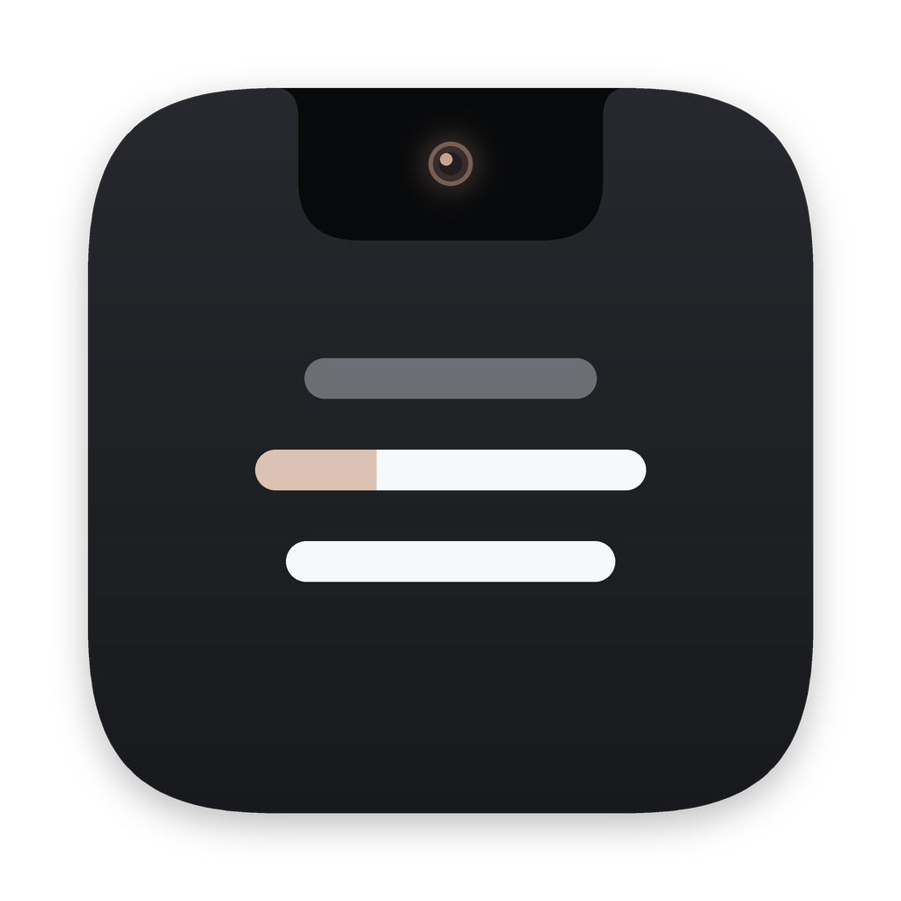
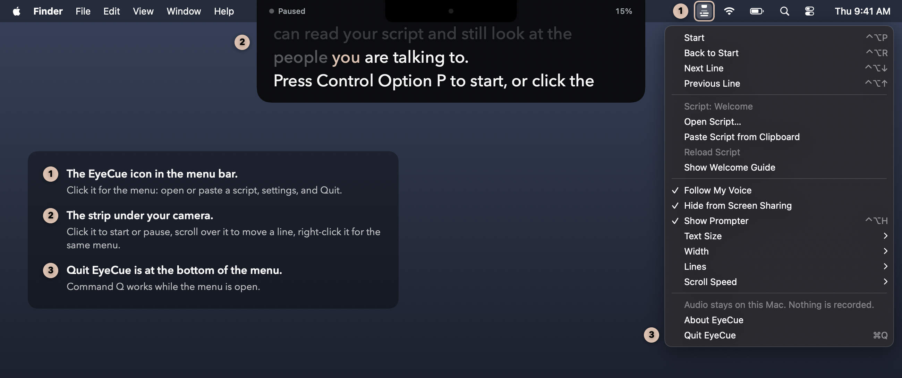
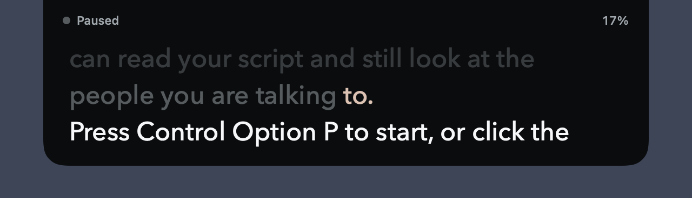

<p align="center"></p>

# EyeCue

A teleprompter that sits right under your MacBook's camera and follows your voice.

Reading a script on a video call makes your eyes drift away from the camera. EyeCue puts the
script in a small strip at the top of the screen, next to the camera in the notch, and moves
along as you talk. It is hidden from screen sharing, so the people on the call see your slides,
not your script.



## What it does

- **Sits by the camera.** The strip hangs from the notch on MacBooks that have one, and from the
  top of the screen on other Macs.
- **Follows your voice.** Apple's speech recognition runs on your Mac and matches what you say to
  the script, a few words at a time. It keeps your place if you pause, ad-lib, misspeak a word or
  skip a sentence, and it ignores side talk like "let me share my screen".
- **Hidden from screen sharing.** The strip is excluded from screen capture, so it doesn't show
  in Zoom, Meet or Teams shares, recordings or screenshots. See [Screen sharing](#screen-sharing).
- **Reads your scripts.** Plain text, Markdown, Word (.docx), RTF, OpenDocument, or paste from the
  clipboard. Slide decks saved as HTML with speaker notes in `data-notes` attributes load one
  slide at a time, with the slide titles as labels.
- **Manual mode.** Turn off Follow My Voice to scroll at a set speed instead.

## Getting started

### 1. Install

EyeCue is built from source, which takes about a minute. You need the Xcode Command Line Tools
(run `xcode-select --install` once) or Xcode. Then in Terminal:

```bash
git clone https://github.com/KevCheek/eyecue.git
cd eyecue
scripts/build-app.sh --install
```

That puts **EyeCue** in the Applications folder in your home folder. Open it with Spotlight
(Command Space, type EyeCue).

### 2. Find it

EyeCue has no window and no Dock icon. When it opens you'll see two things:

- **The strip** under your camera, showing a short welcome guide.
- **The EyeCue icon in the menu bar**, a small notch with three lines under it. Click it for the
  menu.


Can't see the icon? On MacBooks with a notch, a crowded menu bar hides some icons behind the notch.
**Right-click the strip** instead: it opens the same menu.

### 3. Start

Press **Control Option P** (or click the strip, or choose **Start** in the menu). The first time,
macOS asks to let EyeCue use the microphone and speech recognition. Allow both. Then read the
welcome guide out loud and watch the strip keep pace with you.

### 4. Load your script

From the menu, choose **Open Script…** and pick a file, or copy your text and choose **Paste Script
from Clipboard**. **Show Welcome Guide** brings the guide back any time.

### 5. Quit

Choose **Quit EyeCue** at the bottom of the menu (from the menu bar icon or a right-click on the
strip). Command Q also works while the menu is open.

## Using it on a call



The line you just read dims and the next word is highlighted. If you stop to answer a question,
it waits; when you pick up again, even a sentence later, it finds your place.

| Shortcut | Action |
| --- | --- |
| Control Option P | Start or pause |
| Control Option Down / Up | Next or previous line |
| Control Option R | Back to the start |
| Control Option H | Show or hide the strip |

With the mouse: click the strip to start or pause, scroll over it to move by lines, and right-click
it for the menu.

The menu also sets the text size, the strip width, how many lines show, and the scroll speed for
manual mode (when Follow My Voice is off).

To check how a file will be read before a call:

```bash
~/Applications/EyeCue.app/Contents/MacOS/EyeCue --check-script "My talk.md"
```

## Troubleshooting

- **No menu bar icon.** Right-click the strip for the menu. If the strip is hidden too, press
  Control Option H to show it.
- **The strip doesn't move when I talk.** Check that Follow My Voice is ticked in the menu, and that
  EyeCue is allowed under System Settings > Privacy & Security > Microphone and > Speech
  Recognition. If it says on-device speech isn't available, turn on Dictation in System Settings >
  Keyboard so macOS downloads the speech model for your language.
- **It jumped to the wrong place.** Press Control Option Up or Down to nudge it, or scroll over the
  strip. It follows from wherever you put it.
- **People on the call can see it.** Check that Hide from Screen Sharing is ticked, and see
  [Screen sharing](#screen-sharing).

## Privacy

- Speech is recognized **on your Mac only** (`requiresOnDeviceRecognition`). If your Mac can't
  do that for your language, voice follow stays off; EyeCue never falls back to a server.
- Audio is **never recorded or saved**. The microphone is on only while the prompter is running.
- The app runs in the **macOS App Sandbox with no network entitlement**, so macOS itself blocks it
  from reaching the internet. The code has no networking calls, and CI checks that it stays that
  way (`scripts/check-no-network.sh`).
- No accounts, no analytics, no tracking. Your settings are stored in the app's own preferences.

## Requirements

- macOS 14 Sonoma or later, Apple Silicon or Intel.
- Best on a MacBook with a notch and the built-in camera. Works on any Mac.
- For voice follow: on-device speech for your language (see Troubleshooting).

## Screen sharing

EyeCue marks its window as excluded from capture (`NSWindow.sharingType = .none`), the standard
macOS way to keep a window out of screen sharing and recordings. Call apps and macOS versions can
differ, so **do one test share before an important call**: share your whole screen in a test
meeting and check that the strip doesn't appear. If you need it visible (for a tutorial, say), turn
off **Hide from Screen Sharing** in the menu.

Because the strip hides from screenshots, the pictures in this README are drawn by the app itself
(`EyeCue --render-docs docs`) from its real strip, menu and icon.

## Build and test

```bash
scripts/test.sh          # unit tests, no-network check, smoke test
scripts/build-app.sh     # build/EyeCue.app
```

The matching logic lives in `Sources/EyeCueCore` (no UI, fully unit tested). The app is in
`Sources/EyeCue`. `EyeCue --smoke-test <folder>` renders the strip to `prompter.png` without
showing a window or touching the microphone.

Builds are signed ad hoc, which is fine for apps you build yourself. To hand out a prebuilt
download that opens without Gatekeeper warnings, sign it with an Apple Developer ID and notarize it.

## Contributing

Issues and pull requests are welcome. Please keep the privacy guarantees: no network access, no
recording, on-device recognition only. `scripts/test.sh` must pass.

## License

MIT. See [LICENSE](LICENSE).
